# 收票对账系统 · 项目报告书

> 面向韩国免税店 / 百货购物返点业务的**收票 → 识别 → 审核 → 结算 → 对账 → 交付**一体化作业平台。
>
> 本仓库是项目的归档版本，包含：汇报用报告书（本页 + Word/PDF）、功能截图、全部源代码。

| 项目 | 内容 |
|---|---|
| 系统名称 | 收票对账系统（Receipt Reconciliation） |
| 系统定位 | 把"看照片敲字"变成"机器识别 + 人工确认"，打通收票、台账、门店账单、未收、交付整条数据链 |
| 系统状态 | 已上线并投入日常生产使用 |
| 技术栈 | Vue 3 + Vite / Node.js 22 + Express 5 / SQLite / 阿里云百炼 qwen3-vl-plus / PM2 |
| 完整报告 | [Word 版](report/收票对账系统-项目报告.docx) · [PDF 版](report/收票对账系统-项目报告.pdf)（25 页，14 张配图） |

> **关于截图**：所有截图都来自系统的真实构建产物，但页面数据是演示数据，姓名、护照号、票号、团号、金额全部虚构；单据图是程序合成的样张，带 DEMO 水印，不含任何真实客户信息。

---

## 目录

1. [项目概述](#一项目概述)
2. [总体架构](#二总体架构)
3. [功能模块与截图](#三功能模块与截图)
4. [关键技术指标](#四关键技术指标)
5. [质量保障](#五质量保障)
6. [部署与运维](#六部署与运维)
7. [项目状态与后续规划](#七项目状态与后续规划)
8. [仓库结构与运行方式](#八仓库结构与运行方式)

---

## 一、项目概述

### 1.1 业务背景

公司从事韩国免税店与百货的购物返点业务：导游或代理带团在乐天、新罗、新罗爱宝客、新世界、现代等门店消费，公司凭客户的购物小票和护照，向门店结算返点。这个链条上有三方数据必须对得上：

- **客户侧**：每位客户的护照，加上若干张手机拍的购物小票；
- **门店侧**：门店每月出具的账单（Excel），记录实际成交和返点金额；
- **公司侧**：按团号、代理、渠道模式归集的内部台账。

三方一旦对不上，就意味着钱收不回来，或者多付了出去。

### 1.2 原有作业方式的问题

| 环节 | 原有方式 | 主要问题 |
|---|---|---|
| 收票录入 | 人工看照片，把票号、护照号、团号、日期手敲进 Excel | 票号是 13~16 位纯数字，手敲极易出错；量一大，录入就成了瓶颈 |
| 团号归属 | 人工查团号表，判断每张票属于哪个团、哪个渠道模式 | 规则分散在人脑和多份 Excel 里，换人就出错 |
| 账单对账 | 月底拿门店账单和内部台账人工比对 | 几万行逐行比对不现实，漏收很难发现 |
| 未收催收 | 凭印象和零散记录追票 | "账单里有、票没收到"的差集算不清楚，钱就漏收了 |
| 交付 | 人工整理图片文件夹和汇总表发给上家 | 格式因人而异，返工多，也没有留痕 |

### 1.3 建设目标

- 把"看照片敲字"变成"机器识别 + 人工确认"，人只做判断，不做录入；
- 把分散在人脑和 Excel 里的业务规则沉淀成系统配置，做到可查、可改、可追溯；
- 打通"收票 → 台账 → 门店账单 → 未收 → 交付"的完整数据链，任何一张票都能查到它走到了哪一步；
- 全链路留痕，结算、删除、导出等关键动作都能审计和回溯。

### 1.4 使用角色

| 角色 | 职责 | 数据可见范围 |
|---|---|---|
| 收票员 / 审核员 | 上传客户照片建档，在审核台逐张核对识别结果并确认 | 只能看到自己上传的批次 |
| 管理员 | 全流程操作：结算、导入账单、导出交付包、配置业务规则、管理账号 | 全部数据 |
| 财务 | 查看台账、对账结果和交付数据 | 全部数据（以只读为主） |

---

## 二、总体架构

### 2.1 技术架构

| 层次 | 技术选型 | 说明 |
|---|---|---|
| 前端 | Vue 3 + Vite + Pinia + Vue Router | 单页应用，35 个功能页面，构建产物由后端直接托管 |
| 后端 | Node.js 22 + Express 5 | 模块化单体，路由层 / 服务层 / 仓储层分开，按业务域组织 |
| 存储 | SQLite（`node:sqlite` 原生驱动）+ 文件系统 | 账号与客户库、月度对账库分库存放；客户原图和批次数据落盘 |
| 识别 | 阿里云百炼 qwen3-vl-plus（视觉大模型） | 负责单据分类、切图和字段抽取；输入 2400px 高清图，票号做二次校读 |
| 文档处理 | ExcelJS（流式）、sharp、JSZip、PDFKit | 几十万行账单流式导入，交付包打包 |
| 部署运维 | PM2 + 推送式发布 + 腾讯云 COS | 本地构建 → 上传 → 原子软链切换 → 健康检查；数据库和图片异地备份 |

### 2.2 端到端业务流程

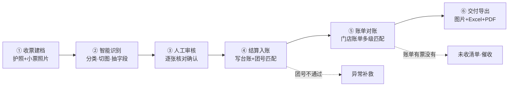

| 阶段 | 输入 | 处理 | 产出 |
|---|---|---|---|
| ① 收票建档 | 客户护照和小票照片 | 按客户建档，自动排队送识别 | 客户档案 + 待审任务 |
| ② 智能识别 | 单据图片 | 分类 → 切图 → 字段抽取 | 结构化字段（票号、团号、日期、护照号等） |
| ③ 人工审核 | 识别结果 + 原图 | 逐张核对、纠错、确认 | 审核通过的客户组 |
| ④ 结算入账 | 审核通过的客户组 | 写台账 + 团号匹配 | 收票台账行（带匹配状态） |
| ⑤ 账单对账 | 门店账单 Excel + 台账 | 按票号、日期、团号、护照多级匹配 | 已匹配 / 未收清单 / 待核对冲突 |
| ⑥ 交付导出 | 已结算且已匹配的数据 | 按渠道模式组织图片和报表 | 交付包（图片 + Excel + PDF） |

### 2.3 核心数据链路

一张小票在系统里的完整生命周期：

**照片 → 识别任务 → 审核确认 → 台账行 → 团号匹配 → 账单匹配 → 月度合并 → 交付包**

其中「团号匹配」决定这张票属于哪个团、走哪个渠道模式，直接影响返点口径；「账单匹配」决定门店认不认这张票、钱能不能收回来。两道匹配没通过的票会分别进入「异常补救」和「未收清单」，不会悄无声息地消失。

---

## 三、功能模块与截图

### 3.1 功能与输入输出总表

| 模块 | 输入 | 输出 |
|---|---|---|
| 收票建档 | 手机拍摄的护照和小票照片（jpg/png/webp/heic） | 客户档案、识别任务、审核批次 |
| 智能识别 | 单据图片 | 单据类型、结构化字段、置信度、异常红标 |
| 审核台 | 识别结果 + 原图 | 确认后的客户组（可结算） |
| 结算入账 | 审核通过的客户组 | 收票台账行（含团号匹配状态） |
| 月度数据导入 | 团号汇总表、日度台账 xlsx | 团号库、台账行 |
| 账单匹配 | 门店账单 xlsx（按渠道分四个桶） | 匹配结果、扣点计算、待核对冲突 |
| 未收清单 | 门店账单与台账的差集 | 催收清单（可导出 Excel） |
| 交付核对与导出 | 已结算数据 | 四桶返点合计、阻断项检查、交付包 zip |
| 配置台 | 业务规则设定 | 渠道模式的记账列、审核必填项、交付格式 |
| 审计日志 | 系统运行中的关键动作 | 可检索的操作留痕 |
| 用户与权限 | 账号与角色设定 | 登录凭据与数据可见范围 |

### 3.2 系统入口与权限

系统是内网 Web 应用，用浏览器访问，账号密码登录。登录后按角色进入不同的工作台：管理员看全局运营概览，审核员看自己的收票任务。登录失败有防暴力破解限流，被锁定时会明确提示还要等多久。

- **输入**：用户名 + 密码
- **输出**：带角色的登录会话（JWT，24 小时有效）

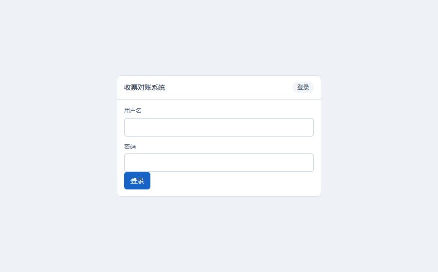

### 3.3 管理员工作台（运营概览）

管理员首页回答三个问题：今天干了多少、谁在干、哪里卡住了。

- **运营概览**：今日上传、审核、导出张数，未清异常存量，今日完成率；
- **收票员工作看板**：每位收票员的收图数、已审数、待审数和完成率，方便调配人力；
- **已完成批次**：完成时间、各类张数、耗时、导出状态；
- **待管理事项**：超时未完成的客户组、未收清单条数、待导出和导出失败的批次，点击可以展开到具体批次。

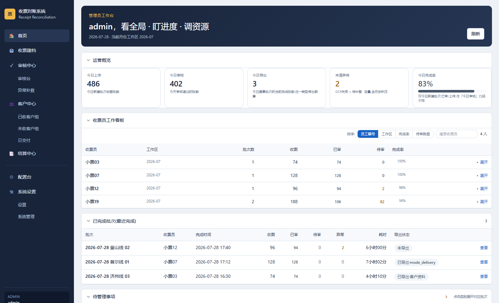

### 3.4 收票建档（系统输入端）

这是整个系统的数据入口。收票员把一位客户的整包照片（护照加若干小票）拖进上传区，系统按客户建档并自动送进识别队列；识别完成后自动进入当前审核批次，不用再手工导入。

客户看板按「异常 / 处理中 / 已完成」三档分类，每行显示收图 → 识别 → 就绪 → 审核的进度。识别失败的图会标红，并给出「重识别 / 补图 / 删除」三个操作。

- **输入**：jpg / png / webp / heic 照片，可以多选整包上传
- **输出**：客户档案（含原图留存）+ 识别任务 + 批次归属

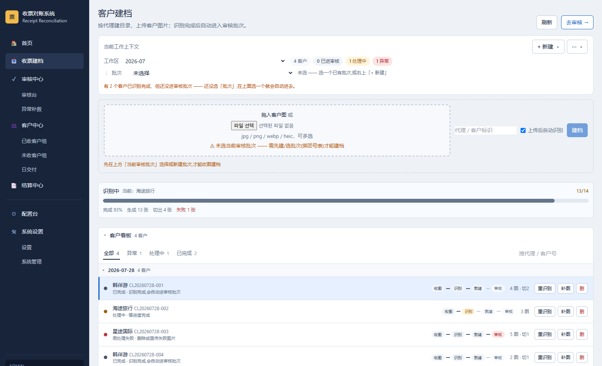

### 3.5 智能识别与人工审核（系统核心）

**识别侧**：一张照片进来后依次经过：

1. **单据分类**：判断是护照、免税店小票、百货小票，还是机票、包装等参考件；
2. **切图**：一张照片里常常拍了多张单据（比如护照和小票同框），系统会切成独立任务；
3. **字段抽取**：小票取店家、票号、团号、购买日期、出境日期，护照取英文名和护照号；
4. **校验与二次校读**：票号按门店规则校验位数（乐天 14 位、新罗 13 位等），可疑时把票号区域裁出来再读一次；还是拿不准的，就留空、标红、转人工，宁可空着也不猜。

<p>
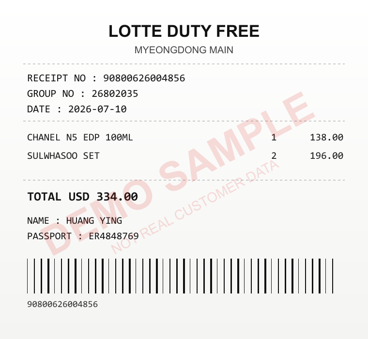
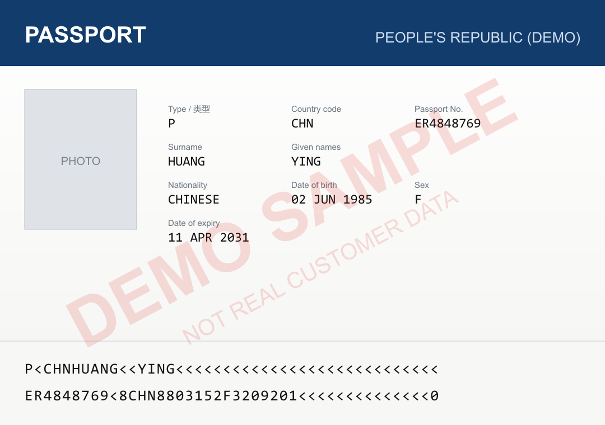
</p>

*演示用的单据样张（程序合成，非真实客户单据）*

**审核侧**：审核台分三栏，左边是客户组队列，中间是单据原图，右边是识别字段和确认操作。审核员的工作是看图核对字段，而不是录入。

- 队列按代理分组，默认只显示待办，支持先进先出、待审优先、异常优先等排序；
- 每张小票先对团号表态（匹配到团号，或确认票上没有团号），然后才解锁字段审核，避免团号张冠李戴；
- 字段逐项标注「通过 / 必改」，快检全部通过的可以一键确认；
- 图片可以缩放、看整张原图、按字段高亮定位；识别错了类型可以一键改判；
- 拍糊、缺页的可以标「重拍」，自动进入异常补救流程，不会混进正常结算。

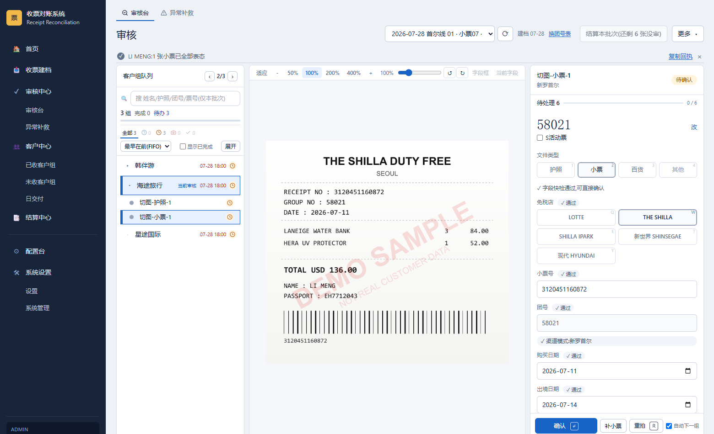

*右侧字段和中间票面逐项对应：票号 3120451160872、团号 58021、购买日期 2026-07-11 都和票面一致，系统已标注「通过」*

### 3.6 结算与收票台账（核心产出）

客户组审核通过后执行「通过并结算」，系统把这位客户的每张小票写进收票台账，同时立即做团号匹配。台账是后续所有对账和交付的唯一数据源。每行台账带两个状态：

- **团号匹配**：团号是否命中团号表，购买日是否落在这个团的起止时间内。不通过的进「异常补救」；
- **账单匹配**：门店账单里有没有对应的这一笔。不通过的进「未收清单」催收。

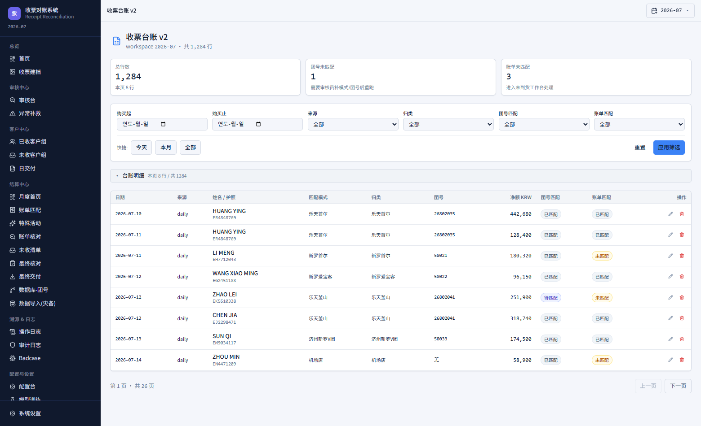

### 3.7 外部数据导入

系统要接入两类外部数据：团号汇总表（决定团号归属和渠道模式）和门店账单（对账基准）。每次导入都完整留痕：文件名、操作人、总行数、导入行数、跳过行数、耗时和状态。大文件走流式解析，实测 28 万行、98MB 的总账可以正常导入，不会把整个文件读进内存。

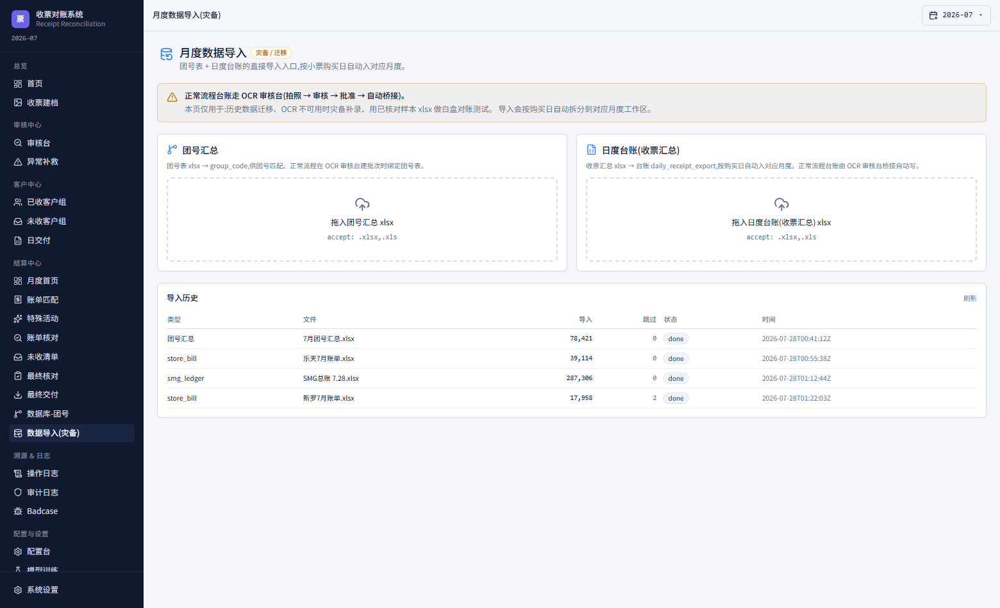

### 3.8 账单匹配对账

门店账单按渠道分成四个业务桶导入，每个桶单独配置扣点率和参与匹配的渠道模式，然后逐桶执行匹配。匹配是多级策略：先按小票号精确匹配，再依次按"购买日期 + 团号"、护照号、姓名等组合匹配；匹配不上或者有歧义的，进人工核对。

- **输入**：门店账单 xlsx（按桶）+ 收票台账
- **输出**：匹配结果和匹配率、扣点后金额、字段冲突待核对清单、未收清单

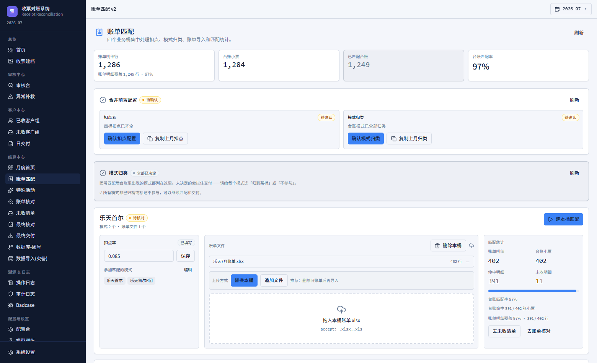

### 3.9 未收清单（漏收兜底）

未收清单回答的是一个很具体的问题：门店账单里有这笔交易，但客户的小票我们没收到。这笔钱正在漏掉，得去追。

每条未收记录锚定「护照号 + 姓名 + 票号」，即使账单重新导入，首次发现的时间也不会丢，方便按逾期天数分级催收。确认收不回来的可以标记作废，避免清单越滚越长。也支持批量延期，或者反向补录进台账。

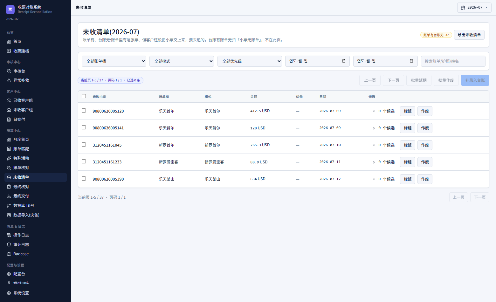

### 3.10 交付核对与导出

交付前先核对四个渠道桶的返点合计、总行数，以及交付阻断项（比如还有未匹配的行）。合计按全量真实数据计算，和页面列表是否分页无关，这一点对财务口径尤其重要。

- **输出**：交付包 zip，内含按渠道模式分文件夹的小票和护照图片、汇总 Excel、客户资料 PDF

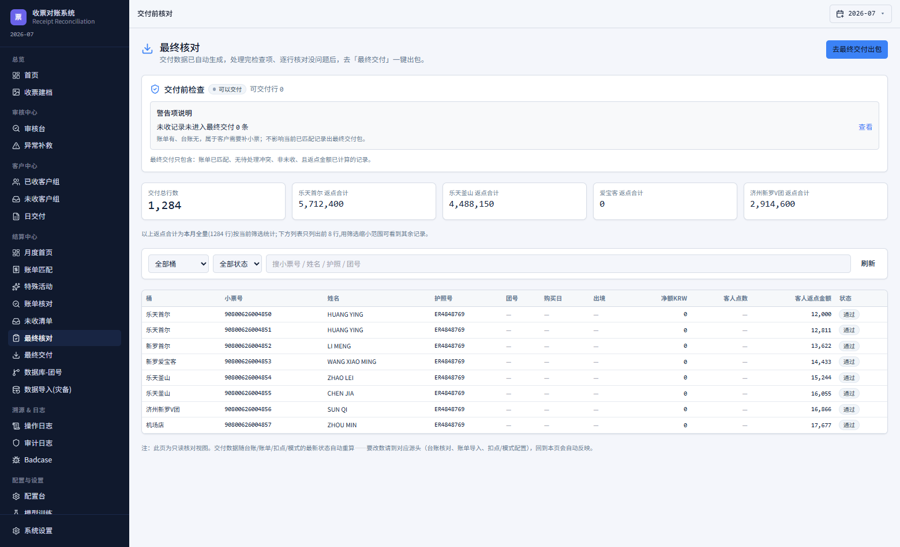

### 3.11 配置台（业务规则可配置）

不同渠道模式的记账口径不一样：有的要记出境日期，有的不用；票号有 13 位、14 位之分；交付给不同上家的文件夹和表格格式也不同。这些规则以前靠人记，现在沉淀进了配置台：

- **渠道模式**：台账记哪些列、审核必审哪些字段、票号导出形态、特殊任务标记；
- **百货店**：乐天、新世界、现代三家各自的必填字段和上家归属规则；
- **交付导出**：给上家的文件夹结构和表格列；
- **字段字典**：系统认识哪些字段（只读）。

配置保存即生效，带版本号和改动历史，改坏了随时可以恢复到系统默认。

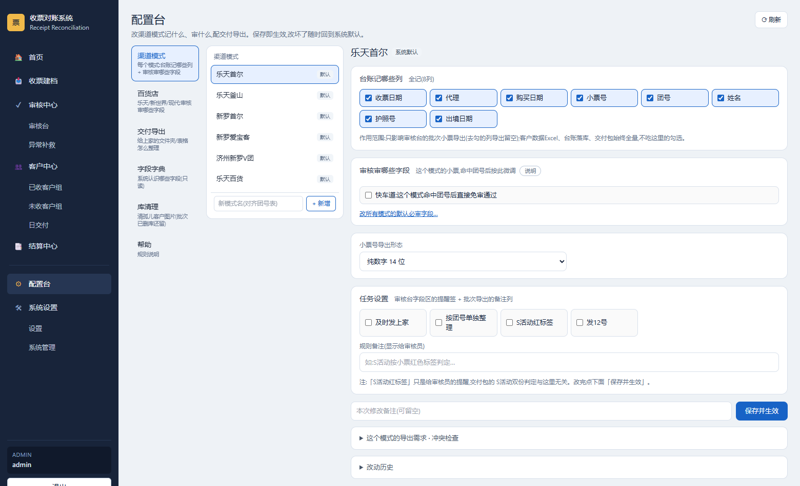

### 3.12 审计日志

和钱、数据安全相关的动作全部留痕：导入、审核通过、结算、台账订正、导出、被拦截的删除等，记录操作人、时间、路由、耗时和结果，可以按类型和时间检索。

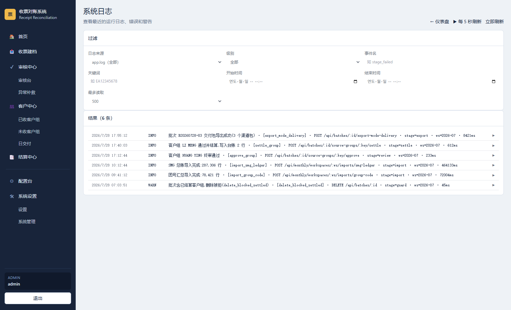

### 3.13 用户与权限

账号按角色授权，审核员只能看到自己上传的批次，避免多人协作时互相干扰或误操作别人的数据。员工编号用于收票汇总表按人分组统计。人员离职时停用账号即可，历史数据完整保留。

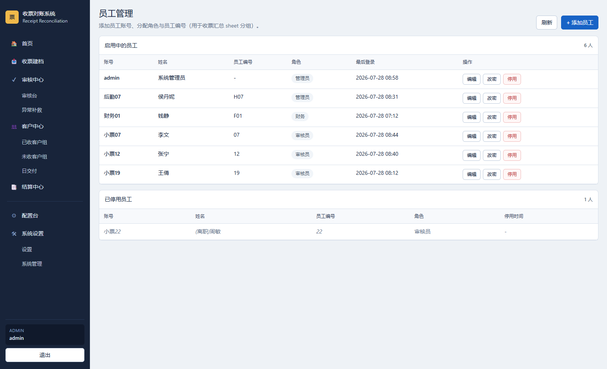

---

## 四、关键技术指标

### 4.1 识别准确率

以 2000 张真实生产图片建立金标数据集（以人工审核后的最终值为标准答案），逐字段比对识别结果：

| 识别项 | 准确率 | 说明 |
|---|---|---|
| 小票号（加权） | **89.1%** | 按各渠道生产实际占比加权；架构升级前是 70.6% |
| 购买日期 | 95.9% | 小票 |
| 出境日期 | 98.3% | 小票 |
| 护照号 | 96.8% | 护照资料页 |
| 英文姓名 | 97.8% | 护照资料页 |
| 单据类型识别 | **99.3%** | 护照 / 小票 / 百货 / 其他四类 |

识别环节的定位是"减轻人工负担"，不是"替代人工"。所有字段最终都由审核员确认后才入账，识别出错由审核环节兜住。

### 4.2 性能与并发

| 指标 | 实测结果 |
|---|---|
| 识别并发能力 | 并发 64、有效 TPM 100 万，全程没有被限流拒绝；连续处理 250 张同样稳定 |
| 日处理能力 | 按日均 1 万张估算，约 2 小时内完成识别 |
| 大文件导入 | 28.7 万行 / 98MB 账单流式导入，内存峰值约 281MB |
| 并发作业 | 30 人同时在线作业压测通过，结算成功率 100%，无死锁 |

### 4.3 运行成本

| 方案 | 每图成本 | 票号准确率 |
|---|---|---|
| 升级前（qwen-vl-max @1280px） | 1.54 分 | 70.6% |
| 当前（qwen3-vl-plus @2400px） | **0.76 分** | **89.1%** |

准确率大幅提升的同时，单图成本降低了约一半。按日均 1 万张计算，识别成本约 76 元/天。

---

## 五、质量保障

### 5.1 自动化测试

| 项目 | 现状 |
|---|---|
| 测试用例 | 2400+ 个自动化测试（`node --test`，用真实 SQLite，不 mock 数据库） |
| 测试文件 | 387 个，覆盖服务层、路由层、前端契约和端到端流程 |
| 持续集成 | 每次提交自动跑代码规范检查、全量测试和前端构建 |
| 发布前置 | 部署脚本内置端到端门禁，不通过就不允许发布 |

### 5.2 数据一致性防线

金融类数据最怕的是"看起来成功了，其实丢了"。系统为此专门建了几道防线：

- **批次写锁**：所有批次数据写入必须先拿锁，杜绝多人同时操作时互相覆盖；
- **已结算保护**：已结算的客户组不能删除、不能改字段，只能走留痕的台账订正通道；
- **乐观锁**：配置类数据带版本号，并发编辑时会明确报冲突，而不是悄悄覆盖；
- **导入失败必留痕**：导入出错会明确标为失败并记录原因，不会卡在"进行中"挡住后面的重导；
- **导出完整性**：交付包里缺图、源文件丢失等情况会明确报出来，不会悄悄少给。

### 5.3 安全与权限

- 密码用 bcrypt 加密存储，登录失败限流，防暴力破解；
- 接口级角色校验，审核员的数据范围在服务端强制隔离，不依赖前端隐藏按钮；
- 关键动作审计留痕，可以追溯到人；
- 敏感配置和密钥不进代码库；交付物中的护照号按需打码。

---

## 六、部署与运维

- **推送式发布**：本地构建前端 → 打包上传服务器 → 原子软链切换版本 → 重启进程 → 健康检查。发布不碰服务器上的业务数据和环境配置，保留最近三个版本，出问题可以秒级回滚。
- **备份**：数据库每天凌晨备份到本地和腾讯云 COS（本地保留 7 份，COS 保留 30 份）；客户原图每天增量镜像到 COS（滚动保留 90 天）；月度交付包导出后同步长期归档。备份脚本会校验真实的上传结果，而不是只看命令退出码。
- **监控与应急**：进程健康检查接口在发布后自动验证；识别服务故障时有降级模型兜底，恢复后自动重识别；长时间没进展的批次由看门狗自动恢复。

---

## 七、项目状态与后续规划

### 7.1 当前状态

| 维度 | 状态 |
|---|---|
| 系统状态 | 已上线，投入日常生产使用 |
| 功能完整度 | 收票 → 识别 → 审核 → 结算 → 对账 → 未收 → 交付，全链路打通 |
| 识别能力 | 票号加权准确率 89.1%，单据分类 99.3% |
| 并发承载 | 30 人同时作业压测通过 |

### 7.2 已知短板

| 问题 | 现状与影响 | 计划 |
|---|---|---|
| 新世界百货票号识别偏低 | 票面是 16 位小字，切片后分辨率到了极限 | 改用原图区域定位方案再读 |
| 现代百货样本不足 | 样本只有个位数，准确率统计意义有限 | 积累样本后重新评估 |
| 跨月票据归属 | 购买月和账单出账月不同的票，未收判定口径待统一 | 方案已设计，待业务拍板后实施 |
| 台账侧订正通道 | 台账行发现错误时，订正入口不够直观 | 规划中 |

### 7.3 后续规划

- **识别准确率**：推进原图区域定位方案，目标是票号整体准确率稳定超过 92%；
- **作业效率**：继续优化审核台操作路径，减少每张票的确认点击次数；
- **对账自动化**：提高账单匹配的自动命中率，压缩人工核对量；
- **上游收票中台（intake）**：从微信 / 企业微信群的消息流里自动采集护照、小票、行程，按护照号归组后交给本系统（已完成规划和 Phase 0 离线验证代码，见 `intake/`）。

---

## 八、仓库结构与运行方式

```
.
├── README.md                    ← 本报告书
├── report/
│   ├── 收票对账系统-项目报告.docx    ← 完整报告（Word）
│   ├── 收票对账系统-项目报告.pdf     ← 完整报告（PDF）
│   └── screenshots/             ← 功能截图 + 合成演示单据
├── sign/                        ← 主系统：收票对账系统（Node.js + Vue 3）
├── intake/                      ← 上游收票中台：规划文档 + Phase 0 验证代码
└── receipt-assistant/           ← 配套小工具：酒店收款凭证助手（Flask + PaddleOCR）
```

### 主系统 `sign/` 本地运行

```bash
cd sign
npm install && npm --prefix frontend install
cp .env.example .env            # 填入 JWT_SECRET、DASHSCOPE_API_KEY 等
npm --prefix frontend run build
npm run workbench               # 默认端口 3218
```

常用命令：`npm test`（全量测试）、`npm run lint`、`node scripts/deploy_push.js`（推送式发布）。更多背景见 `sign/README.md`、`sign/AGENT_SHARED_MEMORY.md` 和 `sign/docs/` 下的 SOP 与设计文档。

### 重新生成报告截图与 Word 报告

```bash
cd sign
npm --prefix frontend run preview -- --host 127.0.0.1 --port 5177   # 另开一个终端
node scripts/oneoff/make_demo_docs.mjs                                # 合成演示单据
SHOT_CHANNEL=chrome node scripts/oneoff/capture_project_report_shots.mjs
node scripts/oneoff/build_project_report_docx.js
```

### 其他子项目

- **`intake/`**：收票中台。`docs/` 里有项目章程、计划书、架构、开发规范、合规规范、运维架构六份文档；`src/` 是归组、打分、组装的 Phase 0 验证代码；`pull/` 是企业微信会话存档拉取（密钥走环境变量，不在仓库里）。`intake-hardening-20260830.bundle` 是一份增量 git bundle，依赖的基础提交没有保存下来，原样存档。
- **`receipt-assistant/`**：酒店住宿费收款凭证自动化：图片 OCR → 匹配人名 PDF → 替换首页 → 归档。说明见 `PROJECT_HANDOVER.md`。

### 归档说明

- 本仓库是一份全新的归档快照（2026-11-09）。主系统的完整开发历史（1099 个提交）保存在私有仓库 `LcokHcak/passport-sign-batch` 的 `refactor-2026-05-vue3` 分支。
- 归档时品牌标识已统一去除：界面品牌改为「收票对账系统」，业务模式名里的公司简称统一替换为「本司」（例如 `乐天SG-本司`）。
- 没有收入本仓库的内容：真实客户样本数据（护照和小票照片）、生产数据库与日志、`node_modules`、安装包、各类大体积 zip，以及 `.env` 和密钥文件。
- 归档时跑了一遍全量测试：2470 个用例中，2448 个通过、2 个跳过、20 个失败。失败的都是测试数据里写死了 2026 年 4 月的日期，超出了业务允许的"前后 6 个月"范围，属于测试数据过期，与功能无关。
