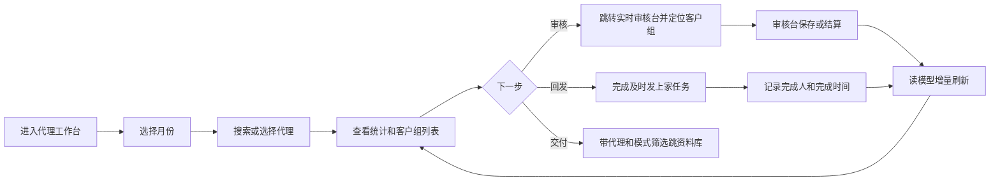

# 代理工作台（Agent Workspace）架构设计

> **已由 V2 替代：** 本文基于批次组和 `workspaceKey` 的方案不再执行。请以
> [代理工作台 V2 架构设计](./2026-07-10-代理工作台V2-架构设计.md) 和
> [Fabel5 实施计划](./2026-07-10-Fabel5-代理工作台V2实施计划.md) 为准。

> 日期：2026-07-10
> 输入：飞书《审核台修改》中的“0709——代理视图工作流-视图-修正方案”与最终 UI Prompt V1.0
> 当前代码基线：`607d281`
> 状态：待用户确认，确认后进入实现

## 1. 结论

“代理视图”应从审核台里的一个前端筛选页签，升级为独立的“代理工作台”。它不是审核页面，也不复制实时审核台，而是以代理为第一视角，连接客户组回溯、模式判断、下一步任务和交付入口。

推荐架构：

1. 新增独立路由 `/agents/:workspaceKey`，按所选月份聚合当前用户有权限看到的全部批次。
2. `batch.json`、`customer.json` 和 `sendback_queue.json` 继续作为业务真相源。
3. 新增 SQLite 可重建读模型 `agent_workspace_group`，专门支持代理列表、统计、客户组分页和筛选。
4. 页面数据全部通过服务端聚合和分页返回，不再把所有批次任务加载到浏览器后临时计算。
5. V1 只接现有“及时发上家/发群/S 活动”回发任务；群聊、自动收票、代理权重、通用规则引擎和 AI 任务只保留字段与接口边界，不实现 UI。

## 2. 已确认的产品边界

### 2.1 页面定位

代理工作台 = 回溯中心 + 工作任务中心。

页面第一眼的信息层级固定为：

`代理 → 客户组 → 模式 → 下一步任务`

### 2.2 用户与权限

- `admin`：查看全部操作员可见的代理与客户组。
- `reviewer`：沿用现有 `operator_scope`，只查看自己有权访问的批次，防止跨操作员数据泄漏。
- `finance`：V1 只读；是否开放由现有角色路由策略决定，不新增编辑权。
- 所有统计的分母必须是“当前用户可见范围”，不能用全局数据给受限用户显示总数。

### 2.3 V1 目标

- 快速找到某个代理。
- 查看该代理当前月份跨批次的客户组收票和审核状态。
- 看清客户组模式以及是否有异常。
- 一键跳到实时审核台对应客户组。
- 查看并完成现有回发任务。
- 带筛选条件跳到资料库或交付入口。

### 2.4 V1 不做

- 不在代理工作台内审核图片或编辑 OCR 字段。
- 不建立代理主数据、代理权重或代理别名维护 UI。
- 不接微信/企业微信，不展示群聊消息。
- 不建设通用任务规则引擎和 AI 任务生成。
- 不把批次 JSON 或客户库迁移成新的主数据库。
- 不复制月度账单核对、待补救和交付包生成逻辑。

## 3. 当前实现的问题

当前 `AgentQueuePanel.vue` 有四个结构性限制：

1. 只接收当前 `ReviewView` 已加载的一个批次任务，无法形成代理跨批次回溯。
2. 代理、客户组、模式、状态全部在浏览器计算；数据大后会卡顿，口径也容易与后端分叉。
3. 没有独立 URL，无法从首页、资料库或任务链接准确返回某个代理。
4. 没有持久任务状态，现有“回发”与代理视图是两个彼此独立的页签。

因此不能在现组件上继续堆卡片。应保留其中成熟的状态判定函数作为参考，但重建独立页面和服务端读模型。

## 4. 交互与低保真原型

### 4.1 页面结构

```text
┌──────────────────────────────────────────────────────────────────────┐
│ 代理视图 · 回溯 & 任务列          月份 2026-07   刷新   去导出交付包 │
├──────────────┬──────────────────────────────────────┬────────────────┤
│ 代理列表 20%  │ 当前代理工作区 60%                    │ 任务栏 20%     │
│              │                                      │                │
│ [搜索代理] 28 │  客户组 56/856  待审 18/218          │ 紧急任务 (3)   │
│              │  完成 34/568     未完全 4/70          │ 待处理任务 (4) │
│ 张代理 56组   │  今日新增 12/86  异常 6/28           │ 已完成任务 (2) │
│ 李代理 42组   │  ─────────────────────────────       │                │
│ 王代理 38组   │  当前代理：张代理（56组）            │ [全部收起]     │
│              │  模式筛选 [全部 ▼]                    │                │
│              │                                      │                │
│              │  001 张三 14:30 32张 已通过 乐天      │                │
│              │      [及时发上家] [去审核台]           │                │
│              │  002 (待识别) 14:25 8张 待审核 新罗   │                │
└──────────────┴──────────────────────────────────────┴────────────────┘
```

### 4.2 视觉规则

- 页面是高频 B 端工作台，使用紧凑三栏，不做大面积卡片或营销式布局。
- 审核状态使用普通文字，只有“已通过”为绿色；不使用多色 Badge。
- 模式是列表最醒目的字段，保留加粗和彩色标签。
- 字号只用 16/14/12 三级，卡片圆角不超过现有设计系统约束；以现有 CSS token 为准，不另造一套主题。
- 右侧任务栏使用折叠组，默认只展开标题或最高优先级组，防止页面无限拉长。

### 4.3 主流程



### 4.4 异常与恢复

- OCR 尚未完成：客户名显示“待识别”，状态显示“识别中”，仍可进入审核台查看。
- 代理为空：统一归入“未标代理”，同时计入异常待处理。
- 模式有多个：一行显示主模式和 `+N`，模式筛选命中任一模式即可。
- 客户组已被删除或批次不存在：API 返回 `stale_reference`，页面提示刷新，不跳空审核页。
- 投影正在重建：页面展示“代理索引更新中”，不回退到全盘扫描 JSON。
- 单个区域加载失败：左、中、右三栏独立错误与重试，不能整页白屏。

## 5. 状态口径

### 5.1 客户组审核状态

状态只由服务端投影生成，前端不得再复制判定逻辑。

| 内部状态 | UI 文案 | 判定 |
|---|---|---|
| `recognizing` | 识别中 | 组内仍有 OCR/预处理任务未完成 |
| `pending_review` | 待审核 | 识别完成，尚无人工审核完成项 |
| `incomplete` | 未完全通过 | 部分完成，或存在重拍、团号待核、模式待确认、待补救 |
| `passed` | 已通过 | 全部必要图片已审核，且客户组已完成结算/通过闭环 |

“已审核图片”但团号或结算仍未完成的客户组不能显示“已通过”。

### 5.2 图片数

列表显示：`原图总数 / 有效图 / 异常图`。

- 原图总数优先来自客户库 `customer.images`，避免把切图任务误当原图。
- 有效图为进入审核且未删除、未重拍的原图。
- 异常图包括重拍、OCR 失败、无法分类或清晰度异常。

### 5.3 任务状态

V1 仅支持已有回发任务：

- `pending`：待处理。
- `overdue`：超过截止时间仍未处理，归入紧急任务。
- `done`：已完成，保留 `sentBy/sentAt/note`。
- `cancelled`：团号确认被撤销等原因自动作废。

“当前只显示及时发上家”解释为“V1 只支持这一类任务”，不是给所有客户组无条件生成一条假任务。

## 6. 数据架构

### 6.1 真相源

| 数据 | 真相源 | 用途 |
|---|---|---|
| 批次、组、任务、审核、模式 | `storage/batches/*/batch.json` | 审核业务真相 |
| 客户、代理、原图 | `customer_library/<workspace>/<customer>/customer.json` | 建档与原图真相 |
| 回发任务 | `storage/sendback_queue.json` | 任务完成与审计真相 |
| 月度交付 | monthly SQLite | 交付入口与后续筛选 |

### 6.2 新增读模型

在现有 workbench SQLite 中新增可重建表：

```sql
CREATE TABLE agent_workspace_group (
  group_id TEXT PRIMARY KEY,
  workspace_key TEXT NOT NULL,
  batch_id TEXT NOT NULL,
  group_key TEXT NOT NULL,
  customer_id TEXT,
  agent_key TEXT NOT NULL,
  agent_name TEXT NOT NULL,
  customer_name TEXT,
  received_at TEXT,
  updated_at TEXT,
  source_image_count INTEGER NOT NULL DEFAULT 0,
  valid_image_count INTEGER NOT NULL DEFAULT 0,
  abnormal_image_count INTEGER NOT NULL DEFAULT 0,
  review_status TEXT NOT NULL,
  settlement_status TEXT,
  stores_json TEXT NOT NULL DEFAULT '[]',
  modes_json TEXT NOT NULL DEFAULT '[]',
  primary_mode TEXT,
  exception_count INTEGER NOT NULL DEFAULT 0,
  owner_user_id TEXT,
  source_chat_group_id TEXT,
  source_message_at TEXT,
  UNIQUE(batch_id, group_key)
);
```

建议索引：

- `(workspace_key, agent_key, received_at DESC, group_id DESC)`
- `(workspace_key, review_status, received_at DESC)`
- `(workspace_key, primary_mode, received_at DESC)`
- `(owner_user_id, workspace_key)`

`agent_key` V1 只做最小文本归一化；不在本期偷偷引入别名推断。以后代理主数据上线后，新增稳定 `agent_id` 并回填，不改变页面 API。

### 6.3 投影更新

- `saveBatch/saveBatchAsync` 已调用 `workbench_sqlite_sync_service.syncBatch`，在同一投影事务中更新该批次的 `agent_workspace_group`。
- 客户原图数量与代理名通过 `workspaceKey + customerId` 从客户库读取，缺失时使用批次字段兜底。
- 部署后执行一次全量重建脚本；读模型可随时从真相源重建，绝不反向写回批次。
- 投影失败记录日志并在 readyz/页面 warnings 暴露，不能静默展示旧数字。

## 7. API 设计

三栏独立加载，避免一个大接口耦合所有数据。

### 7.1 概览

`GET /api/agent-workspace/summary?workspaceKey=2026-07&agentKey=...`

返回：当前代理/当前权限范围的 `groups/pending/passed/incomplete/today/abnormal` 双数字统计、生成时间和投影版本。

### 7.2 代理列表

`GET /api/agent-workspace/agents?workspaceKey=2026-07&q=&page=1&pageSize=50`

返回：代理名、客户组数、待审数、异常数。搜索和分页都在服务端完成。

### 7.3 客户组列表

`GET /api/agent-workspace/groups?workspaceKey=2026-07&agentKey=...&mode=&status=&cursor=&pageSize=50`

使用 `(receivedAt, groupId)` 游标分页，避免实时新增数据导致 offset 翻页重复。每行只返回列表所需字段，不返回图片二进制或整批任务。

### 7.4 任务列表

`GET /api/agent-workspace/tasks?workspaceKey=2026-07&agentKey=&status=pending`

V1 通过 adapter 读取现有 `sendback_queue_repository`。完成动作继续复用现有 `POST /api/sendback-queue/:id/done`，不建立第二套任务真相。

### 7.5 权限

所有接口先走 auth，再调用 `operator_scope` 生成可见批次/owner 条件。客户端传入 `ownerUserId` 或 `agentKey` 不能扩大可见范围。

## 8. 前端模块边界

建议新增：

```text
frontend/src/views/AgentWorkspaceView.vue
frontend/src/components/agent-workspace/
  AgentList.vue
  AgentSummaryStrip.vue
  AgentGroupTable.vue
  AgentTaskRail.vue
  AgentWorkspaceSkeleton.vue
frontend/src/api/agentWorkspace.js
frontend/src/stores/agentWorkspace.js
```

职责：

- View 只负责月份、路由查询参数和三栏编排。
- Store 负责独立请求、刷新、游标分页和 URL 状态同步。
- 组件只渲染服务端给出的状态，不自行扫描任务计算统计。
- 点击客户组跳到 `/review/:batchId?group=<groupKey>&from=agent-workspace`。
- 点击交付跳到资料库并携带 `workspaceKey/agentKey/mode/status`；资料库负责读取这些查询参数并应用筛选。
- 独立页面稳定后，从 `ReviewView.vue` 删除旧 `AgentQueuePanel` 页签，避免两个“代理视图”口径并存。

## 9. 备选方案与取舍

### 方案 A：继续扩展当前 AgentQueuePanel

优点是改动小。缺点是只能看到当前批次，所有计算在浏览器，无法支撑全月和任务中心。拒绝。

### 方案 B：每次请求扫描全部 batch.json/customer.json

优点是不改数据库。缺点是在现有 2 核 4G 和大批次 JSON 下会阻塞主线程，实时刷新越频繁越危险。拒绝。

### 方案 C：真相源不动，新增 SQLite 读模型

改动适中，可服务端分页、索引查询、跨批次聚合，也可以从 JSON 重建。推荐。

## 10. 测试与验收

### 10.1 自动测试

- 状态投影单测：识别中、待审、部分通过、重拍、团号待核、已结算。
- 多代理、多批次、多模式聚合测试。
- 原图数与切图任务数不混淆测试。
- 代理为空、同名、大小写和空格归一化测试。
- API 服务端分页、游标稳定性、搜索、筛选测试。
- reviewer 不能看到其他 owner 数据的权限测试。
- sendback pending/overdue/done/cancelled 任务测试。
- Vue 组件空态、加载态、错误态、分页、URL 回跳测试。
- Playwright 真实 UI：选择代理、模式筛选、进入指定客户组审核、返回后保留筛选、完成回发、进入资料库。

### 10.2 性能门槛

- 10,000 客户组、50 个代理条件下，普通列表 API P95 小于 300ms。
- 页面首屏只加载 50 个代理和 50 个客户组，不返回整批任务 JSON。
- 自动刷新默认 60 秒，提供手动刷新；页面不可因刷新重置当前选择或滚动位置。

### 10.3 业务验收

- 当前代理/全部代理的六组统计数字可人工从样本批次复算一致。
- 客户组按收票时间倒序，新增客户在下一次刷新后出现在顶部。
- “已通过”必须同时满足审核和结算闭环。
- 模式字段明显但不遮挡其他字段；审核状态不使用彩色 Badge。
- 每行“去审核台”准确定位到该客户组。
- 右侧任务完成后记录操作人和完成时间，刷新不回退。
- 资料库跳转保留月份、代理、模式筛选。

## 11. 发布顺序

1. 先上线读模型、重建脚本和只读 API，不暴露导航。
2. 用服务器真实数据做口径对账和性能压测。
3. 上线独立代理工作台，保留旧页签一周用于对照。
4. 指标一致后删除审核台旧代理页签。
5. V1 稳定后再评估代理主数据、群聊来源和通用任务引擎。

## 12. 已知风险

- 当前代理是自由文本，同一代理不同写法会分成两项；V1 明示该限制，不做隐式合并。
- 批次和客户库之间存在旧数据引用缺失时，原图数可能只能回退到批次值。
- 已结算客户组的“审核状态”与月度交付状态不是同一概念；页面只展示组级闭环，交付仍以月度交付页为准。
- 投影属于缓存，任何写接口都不能只更新投影而不更新业务真相源。
